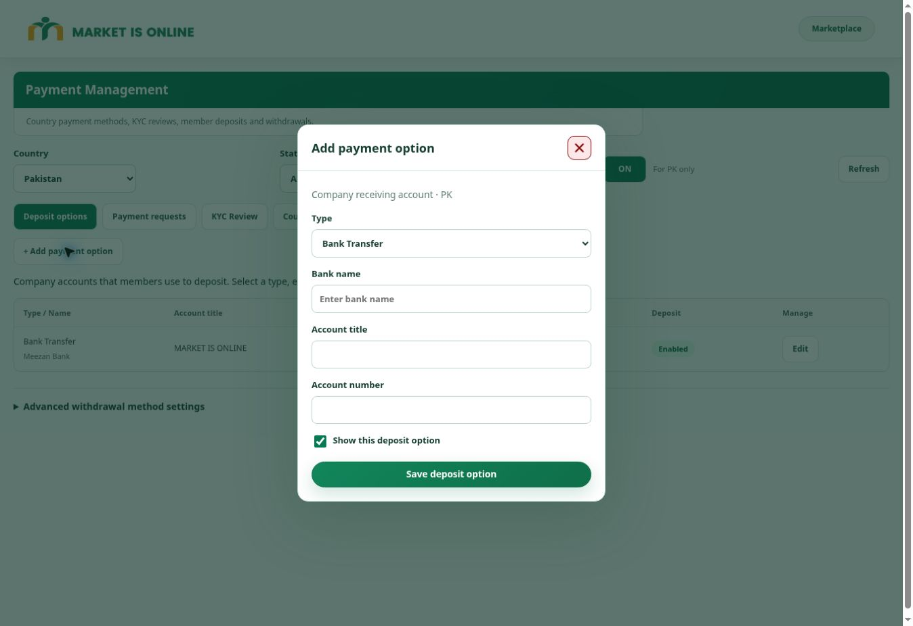
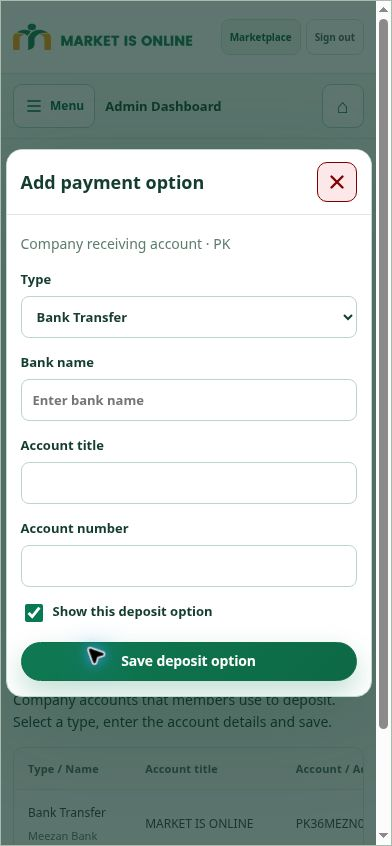
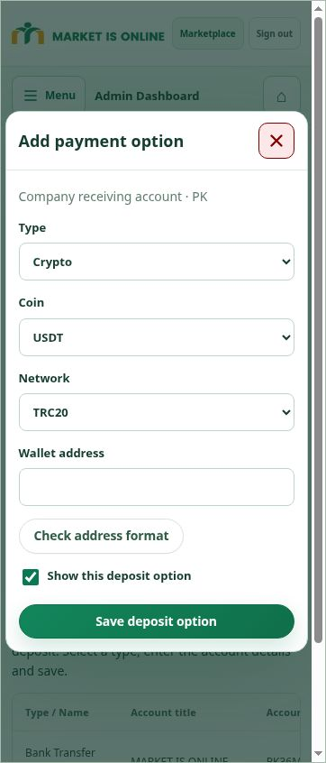

# Simple deposit setup, country KYC policy and tree badges

## Result

Admin → Network Controls → Payment Management now opens **Deposit options**. Select a country, then **Add payment option**:

- Bank Transfer: bank name, account title, account number. An IBAN is accepted but not mandatory for the company's receiving account.
- Mobile Wallet: wallet name, account title, account number.
- Crypto: USDT only, TRC20 / ERC20 / BEP20, receiving address. “Check address format” checks the selected network's syntax; it does not attest wallet ownership, checksum validity, network activity or receipt of funds.

A guarded transaction saves the deposit method and receiving account together. Edits have version checks and an audit event. A dedicated deposit method never changes existing withdrawal methods or saved payout accounts. Members see only enabled options with a receiving account in their profile country. Pending and completed payment snapshots retain their original details.

Country settings retain the local deposit/withdrawal rates and optional USDT deposit conversion rate. A crypto account without a configured rate is saved disabled; configure the rate and enable it to accept deposits. No exchange rate or company account is invented.

The **KYC required** switch applies only to the selected country. OFF permits withdrawals and Proceed Wallet conversions without approved KYC. ON requires approved, unexpired KYC again. The backend enforces the policy using the member's profile country. Existing KYC documents and review status remain intact. Admin role, recent authenticator verification, optimistic version checks and audit logging guard the switch. The production Pakistan setting remains ON with deposit 300 and withdrawal 290.

Trees display the achieved leadership rank badge on the avatar rim without a separate long rank heading. Missing custom badge artwork has an accessible symbol fallback. Member names, topology, avatar colours and parent/child centering are unchanged.

## Verification

- Database integration tests: default ON, country isolation, OFF/ON enforcement for Proceed and withdrawal submission/completion, expired KYC, unchanged identity status, wrong PIN denial, stale version denial, admin/TOTP guards and anonymous permission denial.
- Simple deposit tests: bank account numbers, custom mobile provider, three USDT networks, unsupported coin/network rejection, invalid formats, atomic failed saves, missing-rate gate, rate update, stale account edits, cross-country edits and preservation of the original withdrawal method.
- Existing payment tests: debit/refund/completion, payment proof, idempotency, country rules, historical account/rate snapshots, private files and real-role permissions.
- UI tests: conditional fields, per-type drafts, USDT-only choices, format feedback, duplicate submit protection, KYC switch, withdrawal/Proceed gating and legacy payout controls.
- Tree tests: badge-only nodes in Generation, Binary, Placement and Manager; asymmetric parent/child and viewport centering at desktop and mobile sizes.
- Chromium visual QA with synthetic data: desktop form and 390px/360px mobile forms. Screenshots below use test accounts, not real payment information.
- Production database: migration applied; country rates/default KYC preserved; new public RPCs are security-invoker wrappers and unavailable to anonymous users. No real payments or identity submissions were created for testing.

## Screenshots

## Limits and setup

No real company receiving account is configured yet. An authorized admin must enter the actual bank/wallet/USDT details before users can deposit. Real-money settlement and signed-in production admin form submissions have not been simulated with customer funds. The automated database/UI tests and synthetic browser checks cover those flows without live financial mutations.

The pre-existing Supabase advisory categories remain: legacy callable security-definer functions and [leaked-password protection disabled](https://supabase.com/docs/guides/auth/password-security#password-strength-and-leaked-password-protection). New endpoints do not add anonymously callable functions. Private tables intentionally deny direct client access. This release does not certify 10,000 concurrent users or eliminate all security risks; see the prior payment verification report for load-test scope and remaining platform review.
