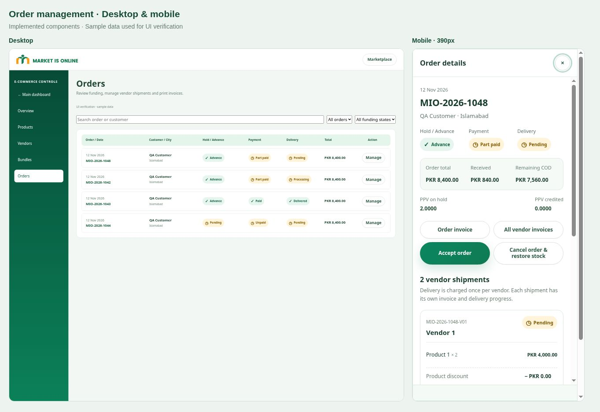

# Vendor orders and network revision — 12 November 2026

## Implemented behavior

- Sponsor network loading now follows the current signed-in session, with separate loading, empty and retry states. Graphical routes load the tree without membership-request panels. The original tree renderer, nodes and positioning are unchanged.
- User to Member Requests is a compact shortcut below the dashboard return, with its expandable panel below Selling & Vendor Invitations. Mobile tree tabs and tools have separate scroll areas.
- Delivery is charged once per distinct vendor across normal products and configured bundles. Each order has immutable vendor shipment/invoice snapshots; historical order totals remain unchanged.
- Bundles 1–2 retain single-vendor selection. Bundles 3–6 retain selections while browsing multiple vendors. Existing unit counts, PPV divisors and discount formulas remain in use; rewards and stock retain the actual vendor attribution.
- Acceptance and fulfillment require verified funding. Security holds never reduce COD. Up to PKR 6,000 the security is 2 MIO / PKR 600; above it the security is 10% of the final order total, with upward MIO rounding at the saved rate. Advances on smaller orders are capped at the order total. The existing regular Shopping Points split rule remains unchanged.
- Vendor shipments advance independently. Parent delivery waits for every vendor. Dispatched shipments block cancellation/stock restoration. COD confirmation is offered after delivery; verified full prepayment is automatically marked paid. Rewards still require delivery and confirmed payment.
- Management actions keep the drawer open. Hold/Advance, Payment and Delivery have separate status indicators. Customer and administrator invoices share one green/white template, vendor charges, payment allocation, real Code 128 barcodes, protected order QR links and print/Save PDF support.
- Payment proof can represent the required advance or the full total; administrator approval verifies the submitted amount. Cancelled orders show no further COD; pending/completed refunds are distinguished. Sponsor guarantee requests display the actual calculated MIO amount.

## Verification completed before release

| Check | Result |
| --- | --- |
| `npm run check` | Passed |
| `npm test` | Passed; 241 reported check groups |
| `npm run test:shopping` | Passed; checkout, referral identity, account controls, membership requests and notifications |
| `npm run test:dashboard` and updated `node tests/account-dashboard.mjs` | Passed; dynamic guarantee amounts and existing dashboard flows |
| `npm run test:maintenance` | Passed; existing maintenance and payout formulas |
| `npm run test:orders` | Passed; PostgreSQL integration, funding boundaries, permissions, shipments, bundles, rewards, refunds and UI behavior |
| Barcode and QR decoding | Both formats decoded from the rendered invoice SVGs using ZXing |
| Browser visual checks | Desktop and 390px mobile orders, persistent drawer, invoices and original tree controls; responsive overflow issues corrected |
| Live database order rollback test | Passed; direct/affiliate shopping signup, funding guards, proof review, vendor fulfillment, delivery/COD sequence, full prepayment, bundle economics and invoice privacy |
| Live database membership rollback test | Passed; distinct referral codes, sponsor placement, admin → Founder flow, mandatory leg, duplicate prevention, notifications and authenticated permissions |
| Post-test data checks | No residual QA accounts; zero invoice/order total mismatches; only Bundles 3–6 allow multiple vendors |
| Database advisors | No new security warnings or health findings. New private table intentionally denies direct access and uses checked RPCs; its new vendor index has no production usage history yet |

Production rollback scripts are in `tests/live-vendor-orders-rollback.sql` and `tests/live-membership-rollback.sql`. UI browser checks used explicit sample fixtures; live database tests exercised real production functions with every write rolled back. No actual payment transfer, customer dispatch, email delivery or authenticated human browser session was claimed by these tests.

Existing database advisor warnings predate this release and remain outside this change. The private shipment table has RLS enabled and all direct customer permissions revoked; its no-policy informational notice is intentional: https://supabase.com/docs/guides/database/database-linter?lint=0008_rls_enabled_no_policy.

## Production release verification

The production Git deployment reported success for `c114f30fcd073055f8af19e1ed3646f6ecc733d5`. All 12 changed frontend/library assets returned HTTP 200 and matched the tested Git blob hashes. The live desktop and 390px mobile bundle layouts loaded correctly. Selecting Bundle 3 focused vendor selection; the live quote returned product total PKR 11,165, discount PKR 1,965.04, retained PPV 1.6940 and final product total PKR 9,199.96. Direct checkout displayed the vendor delivery breakdown and inline account fields, with PKR 600 advance and the correct remaining COD for the tested basket. No order was submitted through the browser.

Only one active vendor was available in the public catalog; the two-vendor purchase and combined bundle/cart delivery calculation were exercised in the live rollback test. The final follow-up corrects the singular vendor label and attaches the responsive UI evidence below.

